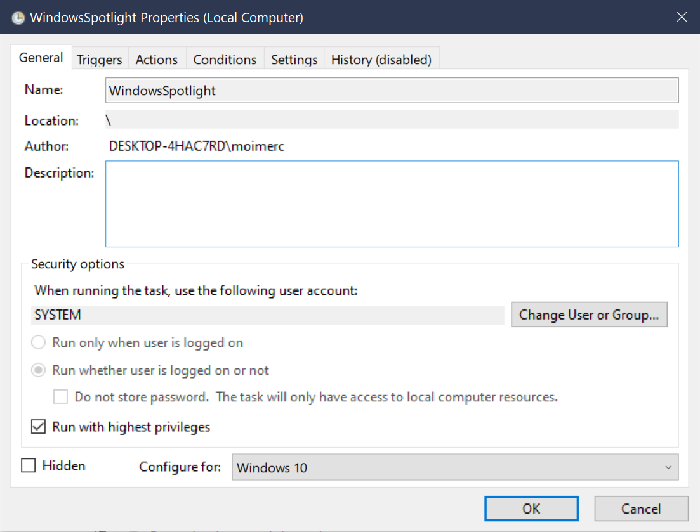
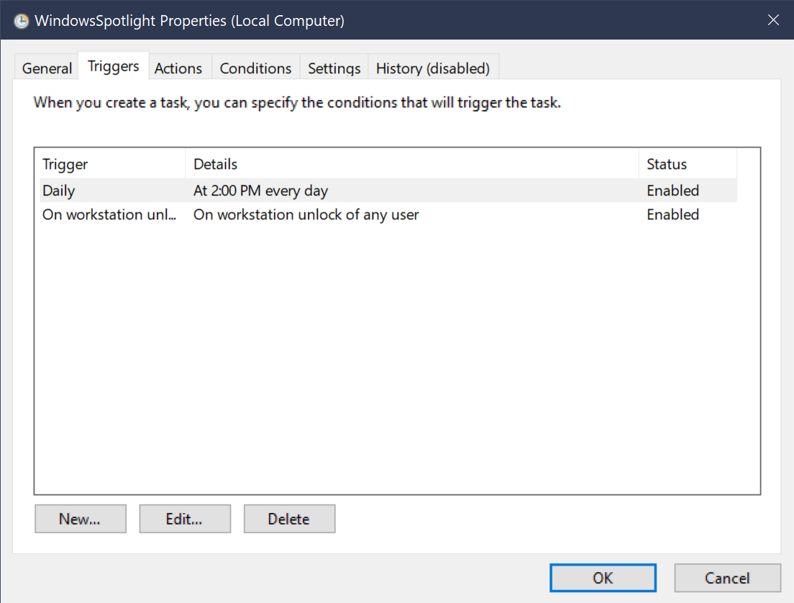
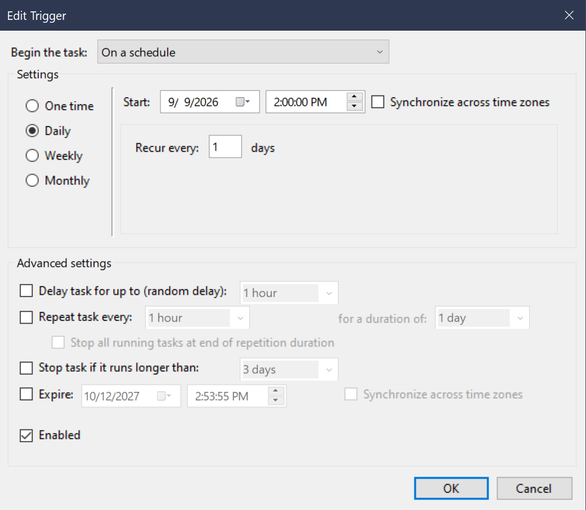
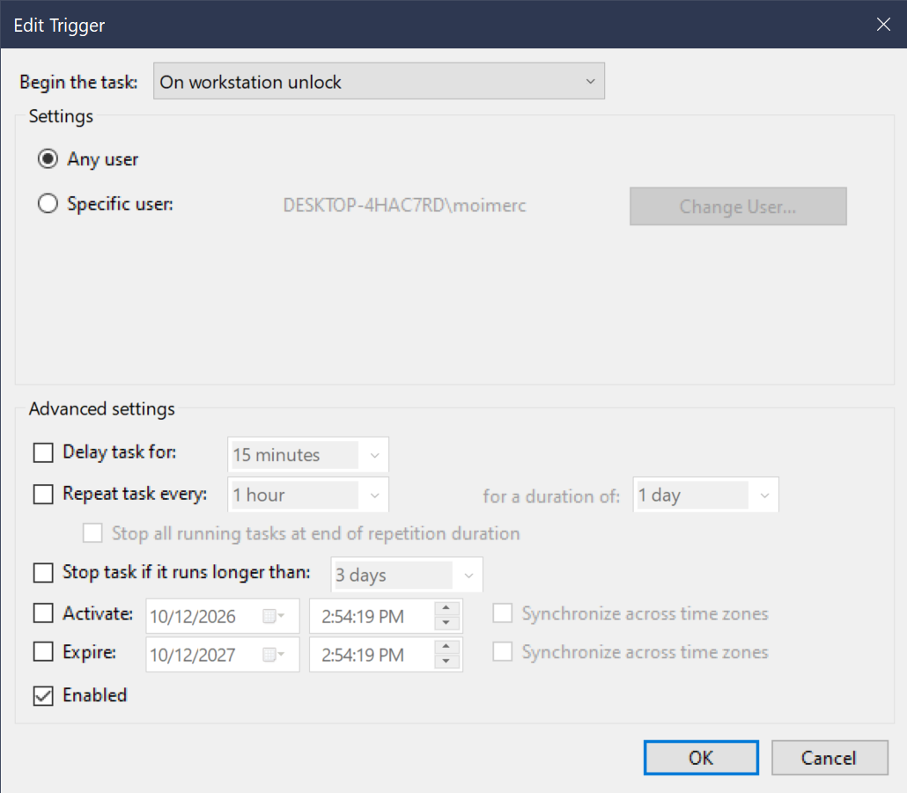
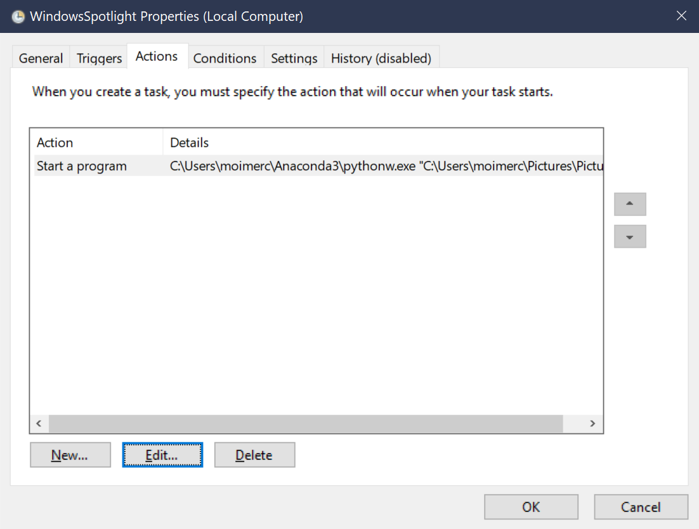
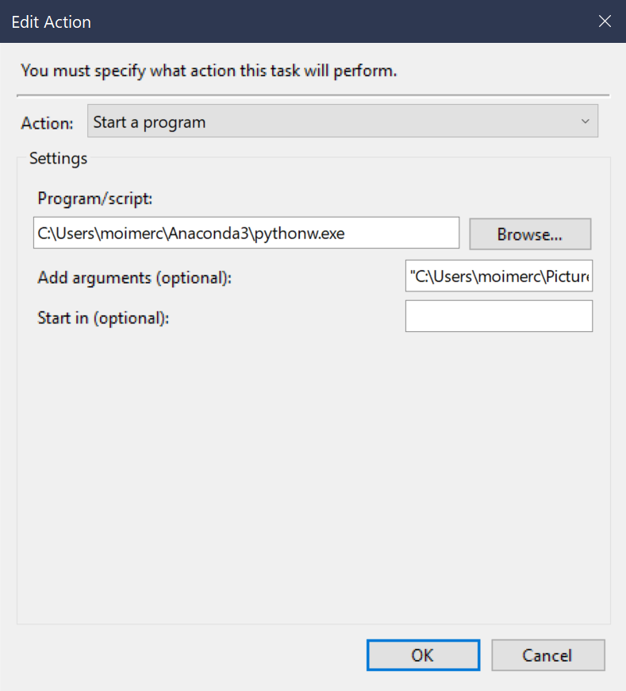
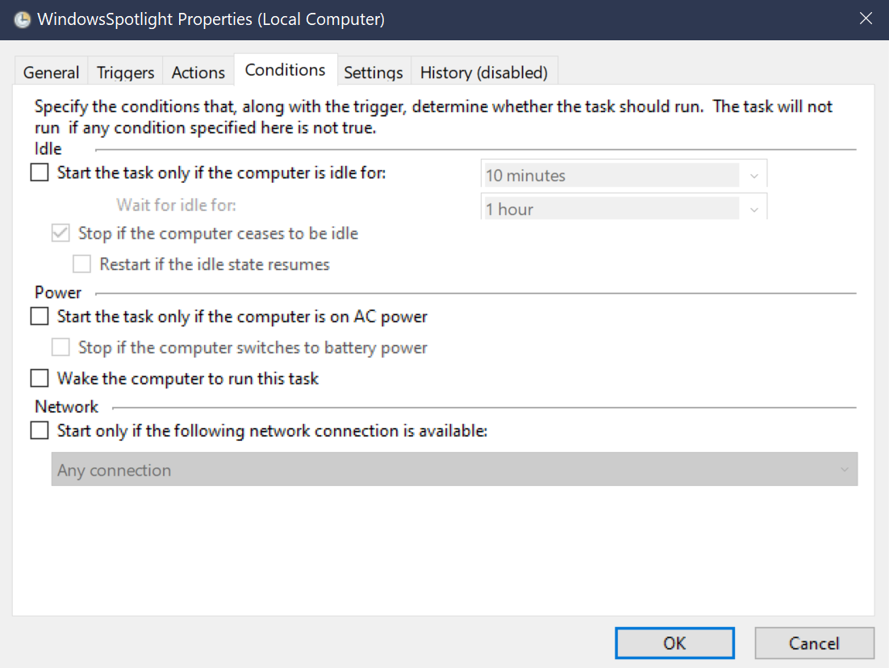
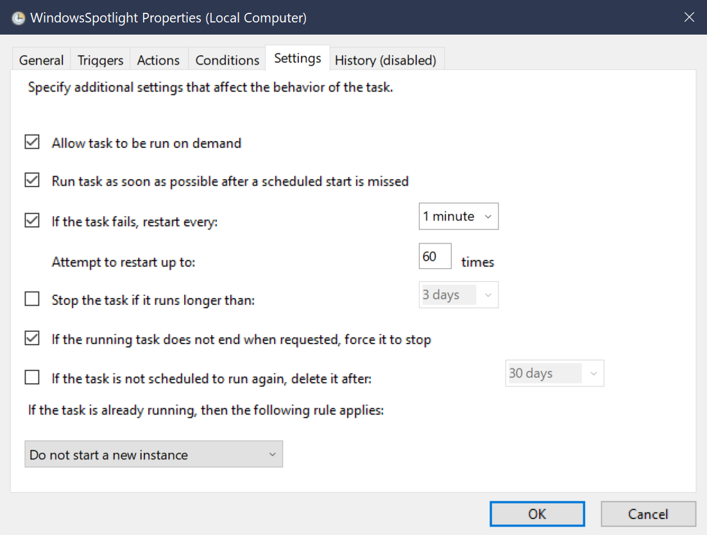
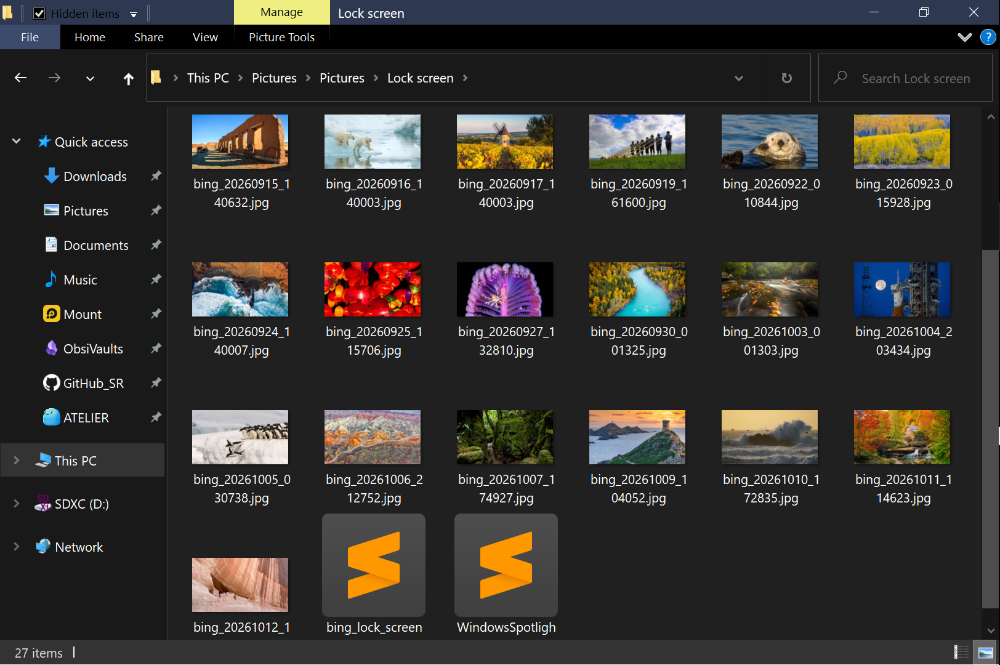

# Windows Spotlight Overrider & Archiver

## Script Overview
This Python utility is designed as a brute-force solution for when the built-in Windows Spotlight feature gets permanently stuck, refuses to update, and standard troubleshooting methods (such as PowerShell resets or registry tweaks) fail. 

Instead of relying on broken Windows APIs, this script manually fetches the Bing Daily Image, archives it locally, directly overwrites the system's lock screen cache, and forces an immediate visual refresh. 

This script is tested on Windows 10.

## Core Features
- **Aggressive Cache Replacement**: Windows occasionally generates multiple or entirely new cache folders for the lock screen. This script iterates through all directories starting with `LockScreen_` inside the hidden `SystemData` path and overwrites every cached image it finds, ensuring the update is applied regardless of how Windows scrambles the folder structure.
- **Local Archiving**: Downloaded images are saved to a specified local directory. Unlike the ephemeral nature of standard Windows Spotlight, you have full control to keep your favorite daily wallpapers or delete them as you see fit.
- **Instant Visual Refresh**: Automatically terminates `LockApp.exe` after cache modification. When you lock the computer (Win + L), Windows is forced to reload and display the newly injected image immediately.
- **Robust Error Handling**: Utilizes native `curl.exe` with built-in retries, timeouts, and automatic DNS flushing (`ipconfig /flushdns`) to resolve specific network errors before failing.

## Setup & Configuration

Before scheduling, open `WindowsSpotlight.py` and configure the following paths:

1. **`DOWNLOAD_DIR`**: The local directory where Bing images and logs will be saved.
2. **`READONLY_DIR`**: The path to your Windows lock screen cache. 
   - *Note: You must replace the SID (`S-1-5-21-...`) in the path with your local machine's actual user SID.*
   - Example: `C:\ProgramData\Microsoft\Windows\SystemData\<YOUR_USER_SID>\ReadOnly`

## Task Scheduler Configuration Guide

Because the script modifies heavily protected system directories (`SystemData`), it must be executed automatically via **Windows Task Scheduler** using the highest system privileges.

Follow the screenshots below to configure the task exactly as required:

### 1. General & Triggers
Ensure the task runs under the `SYSTEM` account with the highest privileges. Set triggers to run both on a daily schedule and upon workstation unlock.

### 2. Actions
Set the action to start a program. 
- **Program/script**: Enter the path to your Python executable (e.g., `pythonw.exe` for silent execution without a console window).
- **Add arguments**: Enter the absolute path to your `WindowsSpotlight.py` script. *Make sure to enclose the path in double quotes `""` if it contains spaces.*

### 3. Conditions & Settings
Ensure the task only runs when a network connection is available, and configure it to retry aggressively (e.g., every 1 minute up to 60 times) if the initial API call fails due to a temporary network drop upon boot.

## Local Archive Result
Once running, the script will silently populate your chosen `DOWNLOAD_DIR` with high-resolution daily images, allowing you to manage your own lock screen gallery.
